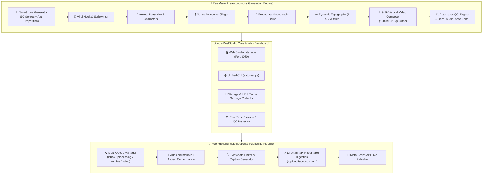

# ⚡ AutoReelStudio — Autonomous AI Video Generator & Meta Reels Publisher

> **AutoReelStudio merges ReelMakerAI and ReelPublisher into a unified, 100% open-source autonomous vertical video production studio and direct Meta Graph API publisher for Instagram Reels (1080x1920 9:16). Runs entirely on local hardware or within containerized cloud environments.**

[](https://github.com/Suraj-8300/AutomatedReelPublisher)
[](https://python.org)
[](https://ffmpeg.org)
[](https://developers.facebook.com)
[](https://instagram.com)

---

## 🏛️ The Merger: ReelMakerAI + ReelPublisher = AutoReelStudio

AutoReelStudio consolidates two previously distinct workflows into a cohesive, full-lifecycle social media studio:



---

## 🌟 Key Subsystems & Capabilities

### 1. 🎨 ReelMakerAI Subsystem (Creation Engine)
* **🧠 Smart Autonomous Idea Engine**: Ranks fresh candidates across 10 genres using hook strength, script fit, and persistent anti-repetition history before selecting the optimal concept.
* **🐾 AI Animal & Character Storytelling Studio**: Creates mini-movies featuring animal characters performing human activities (village bakeries, toy car cruises, camping under stars) across 6 cinematic styles (*Photorealistic 8K, Pixar-Inspired 3D, Ghibli 2D, Makoto Shinkai Anime, Stop-Motion, and Bioluminescent Fantasy*).
* **🤝 Unusual Animal Duos**: Odd-couple archetypes (e.g., Master Baker Kitten & Taster Duckling, Zen Capybara & Baby Chick) with character consistency signatures across cuts.
* **✍️ Custom Prompt Mode**: Input ANY custom idea, question, or premise to synthesize a tailored 9:16 vertical Reel.
* **🎨 6 Modern Subtitle Styles**: Word-by-word active pop *Karaoke*, bold *High-Impact Flash*, *Clean Minimal*, *Cinematic*, *Dynamic Phrase*, and *Meme* with adaptive contrast and safe-zone compliance.
* **🎵 Procedural Soundtrack Engine**: Genre-tailored audio beds (*cyber_pulse, deep_mystery, curiosity_lofi, comedy_bounce, emotional_piano, action_hybrid*).
* **🔍 Automated Quality Control**: Multi-stage QC auditing resolution (1080x1920), audio health (48kHz stereo AAC), speech pacing, and faststart moov atoms.

### 2. 🚀 ReelPublisher Subsystem (Distribution Engine)
* **⚡ 1-Click Generate & Live Publish**: Autonomous end-to-end creation, synthesis, vertical 1080x1920 full-screen composition, and live publishing to Instagram Reels via official Meta Graph API v21.0.
* **⚡ Direct Binary Ingestion (`rupload.facebook.com`)**: Streams local video binaries directly into Meta's official resumable upload servers via HTTPS, eliminating slow third-party tunnels or paid cloud storage.
* **📥 Multi-Queue Operations**: Safe file state handling across `reels_inbox/`, `reels_processing/`, `reels_archive/`, and `reels_failed/`.
* **🛡️ Safe-Zone Compliance**: Guarantees captions, avatars, and visual focal points avoid Instagram UI overlays (top header 220px, bottom metadata 420px).

---

## 🖥️ Web Studio Interface

Launch the studio with a single command:

```bash
python3 server.py
# or
python3 autoreel.py studio
```

Open **`http://localhost:8080`** in your browser to access:
- **Autonomous Mode**: Click **"🎲 Roll Fresh Idea"** to let the engine invent fresh concepts.
- **Custom Idea Mode**: Type any topic (e.g. *"Why cats sleep 16 hours a day"*) to craft a tailored Reel.
- **Animal Story Studio**: Toggle the Animal & Character Studio to craft procedural animated animal stories.
- **Hero 1-Click Generate & Publish**: Autonomous end-to-end creation and live posting to Instagram.
- **Draft Generator**: Video preview and instant spec & QC inspection without uploading.
- **Safe-Zone Overlay**: Real-time visualization of Meta's header and caption safe areas.
- **Archive Gallery**: Browse past generated videos, inspect QC specs, and re-publish anytime.
- **Cache Manager**: Real-time monitoring and 1-click storage cleaning.

---

## 🛠️ Unified CLI Reference (`autoreel.py`)

AutoReelStudio provides a unified CLI that brings together both generator and publisher workflows:

```bash
# 1. Start AutoReelStudio Web Dashboard
python3 autoreel.py studio --port 8080

# 2. Generate a Reel autonomously with default smart engine
python3 autoreel.py make -d 15

# 3. Generate an AI Animal Story Reel (Pixar 3D style kitten making pancakes)
python3 autoreel.py make --animal kitten --style pixar_3d -d 15

# 4. Generate an Unusual Duo Reel (Capybara & Baby Chick in Anime style)
python3 autoreel.py make --duo --style anime -d 15

# 5. Generate a Reel from custom prompt with specific subtitle style
python3 autoreel.py make -p "Why cats sleep 16 hours every day" -g comedy -c high_impact -d 10

# 6. 1-Click Autonomous Generate and Live Publish to Instagram
python3 autoreel.py auto -d 15

# 7. Audit any existing MP4 file against Instagram Reels technical specs
python3 autoreel.py check output/my_video.mp4

# 8. Publish an existing video file to Instagram Reels
python3 autoreel.py publish output/my_video.mp4

# 9. Watch reels_inbox/ for incoming footage and auto-publish
python3 autoreel.py watch

# 10. Run cache garbage collection and storage telemetry
python3 autoreel.py clean

# 11. List catalog topics across all supported genres
python3 autoreel.py topics
```

### Backwards-Compatible Standalone CLIs

Existing scripts and commands continue to work without modification:
* **`python3 generate.py`** — Direct ReelMakerAI video generator
* **`python3 reel_publisher.py`** — Direct ReelPublisher Meta pipeline

---

## ⚙️ Configuration (`.env`)

AutoReelStudio reads credentials and pipeline configurations from `.env`:

```ini
# Meta Graph API Configuration
META_GRAPH_API_VERSION=v21.0
INSTAGRAM_ACCOUNT_ID=17841476861770479
META_ACCESS_TOKEN="YOUR_META_LONG_LIVED_TOKEN"

# Cloud Bridge: "tunnel" (100% Free Zero-Card TLS Bridge) or "r2" / "s3"
STORAGE_PROVIDER=tunnel
AUTO_DELETE_CLOUD_OBJECT=true

# Video Transcoding Options
DEFAULT_SCALING_MODE=pad
VIDEO_TARGET_BITRATE=4.5M
VIDEO_MAX_BITRATE=5.0M
AUDIO_SAMPLE_RATE=48000
AUDIO_CHANNELS=2
```

---

## 🐳 Docker / Container Deployment

Build and run AutoReelStudio in Docker or on Hugging Face Spaces:

```bash
# Build Docker image
docker build -t autoreelstudio .

# Run container on port 7860
docker run -p 7860:7860 --env-file .env autoreelstudio
```

---

## 📁 Project Structure

```text
AutoReelStudio/
├── autoreel.py                  # Unified AutoReelStudio CLI (make, publish, studio, auto, check, clean)
├── generate.py                  # ReelMakerAI Generation Pipeline CLI
├── reel_publisher.py            # ReelPublisher Meta Reels Publisher CLI
├── server.py                    # AutoReelStudio Web Server & API Handler
├── Dockerfile                   # Production & Hugging Face Spaces Container definition
├── requirements.txt             # Python dependencies
├── core/                        # ReelMakerAI Generation Subsystem
│   ├── animal_storyteller.py    # Animal story scripts & visual prompt generator
│   ├── animal_visual_pipeline.py# Visual assets & style composition
│   ├── broll_engine.py          # B-roll footage provider & fallback clips
│   ├── cache_manager.py         # Automated cache GC & LRU retention cleaner
│   ├── character_director.py    # Character consistency & archetypes
│   ├── config.py                # Video, audio, voice, and color palettes
│   ├── content_history.py       # Anti-repetition database & novelty scorer
│   ├── creative_randomizer.py   # Deterministic creative seeds & genre taxonomy
│   ├── genre_catalog.py         # Curated catalog of topics & subgenres
│   ├── hooks_engine.py          # Retention-engineered hooks & narrative starters
│   ├── idea_generator.py        # Smart candidate ranking & LLM synthesis
│   ├── music_engine.py          # Procedural multitrack synthesizer
│   ├── prompt_enhancer.py       # Storyboard & prompt structuring
│   ├── quality_control.py       # 1080x1920 9:16 vertical video spec auditor
│   ├── subtitle_engine.py       # Dynamic ASS subtitle generator (6 typography styles)
│   ├── tts_engine.py            # Edge-TTS neural speech synthesis & word timing
│   ├── video_composer.py        # FFmpeg full-screen vertical 9:16 compositor
│   └── visual_engine.py         # Scene visual builder & motion animator
├── instagram_pipeline/          # ReelPublisher Ingestion & Publishing Subsystem
│   ├── blueprint_generator.py   # Shot list & viral blueprint generator
│   ├── cloud_bridge.py          # Direct binary ingestion & resumable uploader
│   ├── config.py                # Instagram technical limits & safe-zone metrics
│   ├── metadata_linker.py       # Caption, hashtag, and location metadata builder
│   ├── preprocessor.py          # Aspect-ratio normalizer & audio resampler
│   ├── publisher.py             # Meta Graph API v21.0 container creator & publisher
│   └── queue_manager.py         # Multi-queue file state controller
├── static/                      # Studio Web Frontend Assets
│   ├── css/style.css            # Dark-mode studio styling & safe-zone guides
│   ├── js/main.js               # Reactive frontend logic & REST client
│   └── preview.webp             # Portfolio preview thumbnail
├── templates/
│   └── index.html               # AutoReelStudio dashboard UI template
└── tests/
    └── test_generation_engine.py# Automated test suite
```

---

## 📄 License
MIT License. Created by Suraj Dhere ([@Suraj-8300](https://github.com/Suraj-8300)).
