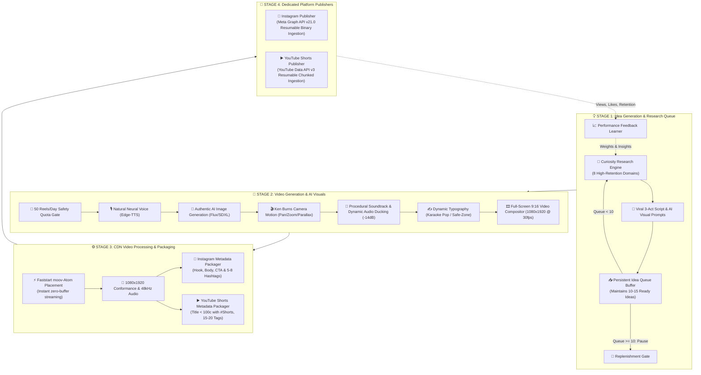

# ⚡ AutoReelStudio — Autonomous 4-Stage Multi-Platform Video Production Studio

> **AutoReelStudio is an enterprise-grade autonomous vertical video production studio and multi-platform social publisher for Instagram Reels and YouTube Shorts (1080x1920 9:16). Built on a modular 4-stage pipeline that handles everything from autonomous curiosity research to direct API publishing.**

[](https://python.org)
[](https://ffmpeg.org)
[](https://developers.facebook.com)
[](https://developers.google.com/youtube)
[](https://instagram.com)

---

## 🏛️ Modular 4-Stage Pipeline Architecture

AutoReelStudio is organized into four decoupled, industrial-grade stages:



---

## 🌟 Deep Dive into the 4 Stages

### 1. 💡 Stage 1: `idea_generation/` (Research & Queue Engine)
* **Industry-Grade Curiosity Research**: Replaced hardcoded static templates with deep dynamic curiosity mining across 8 high-engagement categories (*Science Paradoxes, Dark Psychology & Cognitive Quirks, Ancient Baffling Tech, Ocean Abyss & Cosmic Anomalies, Deep Tech & DNA Storage, Nature Wonders*).
* **Viral 3-Act Narrative Architecture**:
  - **Act 1 (0-3s)**: High-retention pattern-interrupt hook sentence to stop thumb scrolling.
  - **Act 2 (3-12s)**: Escalation of the mystery with surprising verified mechanics.
  - **Act 3 (12-15s)**: Memorable philosophical, scientific, or emotional payoff.
* **Scene-by-Scene AI Visual Storyboards**: Generates detailed, photorealistic prompt descriptors for every scene (*8k, volumetric light, depth of field, Unreal Engine 5 aesthetic, 9:16 vertical*).
* **10-to-15 Buffer Queue Policy**:
  - Maintains a persistent pool of **10 to 15 pre-approved, ready-to-produce ideas** (`data/idea_queue.json`).
  - **Auto-Replenish**: If queue drops below 10 ideas, it autonomously initiates research and replenishes back to 15.
  - **Auto-Pause**: If queue has 10 or more ideas, generation pauses to preserve resources.
* **Feedback Learner**: Logs past published reel performance and computes dynamic multipliers to prioritize trending topics.

---

### 2. 🎥 Stage 2: `video_generation/` (AI Visuals & Natural Audio)
* **50 Reels/Day Safety Quota Gate**:
  - Strictly enforces the user safety ceiling of **50 reels generated per calendar day** (`data/daily_quota.json`) to prevent API throttling and maintain high quality.
* **Authentic AI Visual Generation (Zero Stock Footage)**:
  - Generates bespoke, high-definition AI imagery per scene using Flux / SDXL neural architectures with aesthetic procedural fallbacks.
  - Animates static AI frames into breathing vertical video clips using smooth **Ken Burns zoom-ins, zoom-outs, horizontal pans, and parallax camera movements** at 30/60 FPS.
* **Natural Voice Synthesis**:
  - High-fidelity Microsoft Neural Speech models (*Christopher, Guy, Jenny, Ava, Andrew*) with natural conversational cadence and sub-word timestamp extraction.
* **Audio Ducking (-14dB)**:
  - Procedural multitrack music bed is dynamically attenuated by **-14dB** during narration, surging back up during dramatic pauses and the outro.
* **Dynamic Typography (ASS Subtitles)**:
  - Word-by-word active pop *Karaoke*, *High-Impact Flash*, or *Clean Minimal* subtitles positioned safely above Instagram and YouTube UI buttons (bottom margin $\ge$ 450px).

---

### 3. ⚙️ Stage 3: `video_processing/` (CDN Optimization & Metadata Packaging)
* **Faststart `moov` Placement**:
  - Re-encodes container with `-movflags +faststart` placing header metadata at the head of the file for instant, zero-buffer playback on mobile CDNs.
* **Technical Conformance**:
  - Verifies exact 1080x1920 9:16 vertical geometry, H.264 profile, YUV420p chroma, and 48kHz stereo AAC audio.
* **Tailored Platform Metadata Packaging**:
  - **Instagram Package**: Generates narrative paragraphs, engagement CTA, and 5-8 targeted hashtags.
  - **YouTube Shorts Package**: Generates click-worthy title ($<$ 100 characters) ending with `#Shorts`, rich description, and 15-20 viral tags (`Shorts`, `YouTubeShorts`, `Science`, `Viral`, `DidYouKnow`).

---

### 4. 🚀 Stage 4: `publishers/` (Platform Publishing)
* **Instagram Publisher (`publishers/instagram/`)**:
  - Direct Meta Graph API v21.0 binary upload to `rupload.facebook.com`.
  - 4-tier operational queue (`reels_inbox/`, `reels_processing/`, `reels_archive/`, `reels_failed/`).
* **YouTube Shorts Publisher (`publishers/youtube/`)**:
  - YouTube Data API v3 OAuth 2.0 flow & token management (`client_secret.json`).
  - Resumable chunked video upload (`videos.insert`) with `#Shorts` classification.

---

## 🛠️ Unified CLI Reference (`autoreel.py`)

```bash
# 1. Inspect the 10-15 idea buffer queue
./venv/bin/python3 autoreel.py queue

# 2. Force replenish idea queue to 15 ideas
./venv/bin/python3 autoreel.py queue replenish

# 3. Check today's 50-reels quota telemetry
./venv/bin/python3 autoreel.py quota

# 4. Generate video from next idea in queue with AI visuals
./venv/bin/python3 autoreel.py make -d 15

# 5. Generate video from a custom prompt
./venv/bin/python3 autoreel.py make -p "The quantum eraser experiment" -d 15

# 6. Run CDN processing and generate metadata packages
./venv/bin/python3 autoreel.py process output/sample.mp4

# 7. Publish to Instagram Reels or YouTube Shorts
./venv/bin/python3 autoreel.py publish instagram output/sample.mp4
./venv/bin/python3 autoreel.py publish youtube output/sample.mp4

# 8. 1-Click Autonomous Multi-Platform Pipeline
# (Pops Idea -> Checks Quota -> Generates Video -> CDN Prep -> Publishes to Both)
./venv/bin/python3 autoreel.py auto --target both -d 15

# 9. Launch AutoReelStudio Web Dashboard
./venv/bin/python3 autoreel.py studio --port 8080
```

---

## 📺 How to Connect YouTube Shorts (Step-by-Step)

You already configured Google Cloud Project `reelautomation-513818` and provided `client_secret.json`. To complete the one-time channel link:

1. In your terminal, run the authorization helper:
   ```bash
   ./venv/bin/python3 autoreel.py auth-youtube
   ```
2. The terminal will print your Google authorization link:
   ```text
   👉 https://accounts.google.com/o/oauth2/auth?response_type=code&client_id=198990477835...
   ```
3. Open the link in your browser, select your YouTube channel account, and click **Allow**.
4. The local listener on port `8000` (`http://localhost:8000/auth/youtube/callback`) will capture the token and save `youtube_token.json`.
5. You are ready! You can now publish to YouTube Shorts with `./venv/bin/python3 autoreel.py auto --target both`.

---

## 📁 Modular Directory Structure

```text
AutoReelStudio/
├── autoreel.py                  # Master CLI Orchestrator
├── client_secret.json           # Google OAuth credentials (gitignored)
├── requirements.txt             # Dependencies
├── server.py                    # Web Studio Server & REST APIs
├── data/                        # Persistent Storage
│   ├── idea_queue.json          # 10-15 Idea Buffer Queue
│   ├── daily_quota.json         # 50 Reels/Day Quota Tracker
│   └── performance_history.json # Learning & Feedback Telemetry
├── idea_generation/             # STAGE 1: Ideation & Research
│   ├── research_engine.py       # Curiosity Mining & Storyboard Synthesizer
│   ├── queue_manager.py         # 10-15 Buffer Queue Controller
│   └── feedback_learner.py      # Insights & Dynamic Weights
├── video_generation/            # STAGE 2: AI Video & Natural Audio
│   ├── quota_governor.py        # 50 Reels/Day Ceiling Gate
│   ├── ai_visual_engine.py      # AI Image Synthesis & Ken Burns Camera Motion
│   ├── voice_engine.py          # Edge Neural TTS & Word Timings
│   ├── audio_master.py          # Soundtracks & -14dB Audio Ducking
│   ├── subtitle_engine.py       # Dynamic ASS Subtitle Generator
│   ├── composer.py              # Full-Screen 9:16 Video Assembler
│   └── generator.py             # Video Synthesis Pipeline
├── video_processing/            # STAGE 3: CDN Processing & Metadata
│   ├── cdn_optimizer.py         # Faststart moov-Atom & 1080x1920 Conformance
│   └── metadata_packager.py     # Instagram & YouTube Metadata Tailorer
├── publishers/                  # STAGE 4: Dedicated Publishers
│   ├── instagram/               # Meta Graph API v21.0 Publisher
│   │   ├── publisher.py         # Direct Ruploade Binary Streamer
│   │   └── queue_manager.py     # Multi-Queue State Manager
│   └── youtube/                 # YouTube Data API v3 Shorts Publisher
│       ├── auth.py              # OAuth 2.0 Flow & Port 8000 Listener
│       └── publisher.py         # Resumable Chunked Video Uploader
├── static/                      # Studio Web Dashboard Assets
├── templates/                   # Studio HTML UI
└── tests/                       # Unit & Modular Architecture Tests
```

---

## 📄 License
MIT License. Created by Suraj Dhere ([@Suraj-8300](https://github.com/Suraj-8300)).
