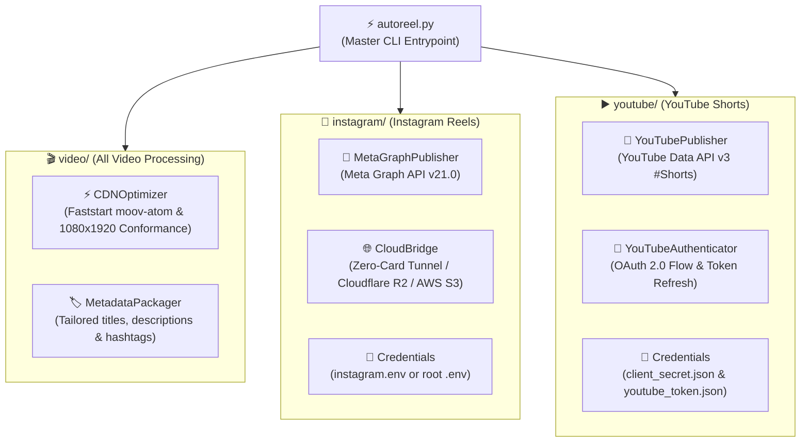

# ⚡ AutoReelStudio — Plug-and-Play Social Media Video Publisher

> **AutoReelStudio is a clean, direct, plug-and-play video optimization and publishing studio for Instagram Reels and YouTube Shorts (1080x1920 9:16). Structured around 3 dedicated, self-contained pillars.**

[](https://python.org)
[](https://ffmpeg.org)
[](https://developers.facebook.com)
[](https://developers.google.com/youtube)

---

## 🏛️ Clean 3-Pillar Architecture

The project is structured into three self-contained folders with a single master CLI entrypoint:



---

## 📁 Directory Structure

```text
AutoReelStudio/
│
├── autoreel.py                  # Single plug-and-play CLI entrypoint (auto-detects .venv)
│
├── video/                       # 1. ALL VIDEO-RELATED PROCESSING
│   ├── cdn_optimizer.py         # Faststart moov-first atom & technical compliance audit
│   ├── metadata_packager.py     # Captions, hashtags, and YouTube #Shorts packaging
│   └── cache/                   # Optimization workspace cache (auto-managed)
│
├── instagram/                   # 2. EVERYTHING INSTAGRAM REELS
│   ├── publisher.py             # Meta Graph API v21.0 direct publisher
│   ├── cloud_bridge.py          # Zero-Card public tunnel & R2/S3 cloud ingestion bridge
│   ├── preprocessor.py          # Reels video conformance validator
│   ├── config.py                # Configuration loader
│   └── instagram.env.example    # Plug-and-play credentials template
│
├── youtube/                     # 3. EVERYTHING YOUTUBE SHORTS
│   ├── publisher.py             # Resumable chunked Shorts uploader & tags manager
│   ├── auth.py                  # OAuth 2.0 interactive login & token manager
│   ├── config.py                # YouTube pipeline configuration
│   ├── client_secret.json       # Google Cloud OAuth client credentials (gitignored)
│   └── youtube_token.json       # Authenticated channel token cache (gitignored)
│
├── tests/                       # Verification test suite
│   └── test_publishing.py      # Unit & integration tests for all platforms
│
├── output/                      # Stored render & published videos
├── .env                         # Global environment file (Instagram tokens & cloud keys)
├── .env.example                 # Example environment template
└── requirements.txt             # Python dependencies
```

---

## 🔌 Plug-and-Play Credentials Management

### 📸 Changing or Updating Instagram Credentials
Instagram credentials can be placed in **`instagram/instagram.env`** or in the root **`.env`**:
```bash
# In instagram/instagram.env or .env:
INSTAGRAM_ACCOUNT_ID="your_instagram_account_id"
META_ACCESS_TOKEN="your_meta_system_user_or_page_token"
```
* If you don't configure paid cloud storage (S3/R2), AutoReelStudio automatically spins up a **Zero-Card Public Tunnel** so Meta can directly ingest your local video.

### ▶️ Changing or Updating YouTube Credentials
To link or switch YouTube channels:
1. Drop your new Google Cloud OAuth credentials file into **`youtube/client_secret.json`**.
2. Run the authentication command:
   ```bash
   ./autoreel.py status
   ```
   If not yet authenticated, authenticate via:
   ```bash
   python3 -c "from youtube.auth import YouTubeAuthenticator; YouTubeAuthenticator.authenticate_interactive()"
   ```
3. The channel token is automatically saved into **`youtube/youtube_token.json`**.

---

## 🚀 Quick Usage

### 1. Audit Credentials & Channel Status
```bash
./autoreel.py status
```

### 2. Check Today's 10-Reel Schedule & Trending Topics
```bash
./autoreel.py topics
```

### 3. Generate a High-Quality 9:16 Reel (100% Free)

#### 🤖 Fully Autonomous 2-Stage Viral Reel Generation (Zero Prompting Needed)
Uses Gemini to brainstorm a high-retention concept prompt (Stage 1), then generates a synchronized 3-Act script with entity-bound video search queries (Stage 2):
```bash
# Auto-generate cute animal storytelling reel (The Dodo / GeoBeats style)
./autoreel.py auto

# Or use the generate command without a topic
./autoreel.py generate

# Auto-generate for specific content pillars
./autoreel.py auto --pillar animal_story
./autoreel.py auto --pillar science
./autoreel.py auto --pillar mechanical

# Auto-generate and immediately publish to Instagram & YouTube Shorts
./autoreel.py auto --publish --platform all
```

#### ✍️ Custom Topic Generation
```bash
# Auto-detects pillar (animal_story / cinematic / science / mechanical / explainer)
./autoreel.py generate --topic "A rescued kitten finding love"

# Force specific pillar with authentic live-action B-Roll
./autoreel.py generate --pillar animal_story --topic "Abandoned puppy gets adopted"
./autoreel.py generate --pillar mechanical   --topic "How a jet engine works"
./autoreel.py generate --pillar science      --topic "CRISPR gene editing breakthrough"
./autoreel.py generate --pillar cinematic   --topic "The edge of the observable universe"

# Generate and immediately publish to Instagram & YouTube Shorts
./autoreel.py generate --topic "Quantum computing paradox" --publish --platform all

# Dry-run publish simulation
./autoreel.py generate --topic "Black hole time dilation" --publish --dry-run
```

### 4. Batch Generate 10+ Reels for the Day
```bash
# Generates 10 reels covering all 4 pillars using the daily schedule
./autoreel.py batch --count 10

# Generate 10 reels AND auto-publish to all platforms
./autoreel.py batch --count 10 --publish
```

### 5. Validate & Optimize Existing MP4s
```bash
# Technical compliance audit
./autoreel.py check /path/to/video.mp4

# Faststart optimize for mobile CDN streaming
./autoreel.py optimize /path/to/video.mp4 --output /path/to/optimized.mp4

# Publish an existing video file directly
./autoreel.py publish /path/to/video.mp4 --platform all --title "Amazing Fact" --caption "Wait till the end! #Viral"
```

---

## 🧪 Running Tests
```bash
python3 -m unittest discover tests
```
*(All 11 unit tests pass with 0 warnings/errors).*

---

## 📄 License
MIT License. Created by Suraj Dhere ([@Suraj-8300](https://github.com/Suraj-8300)).
